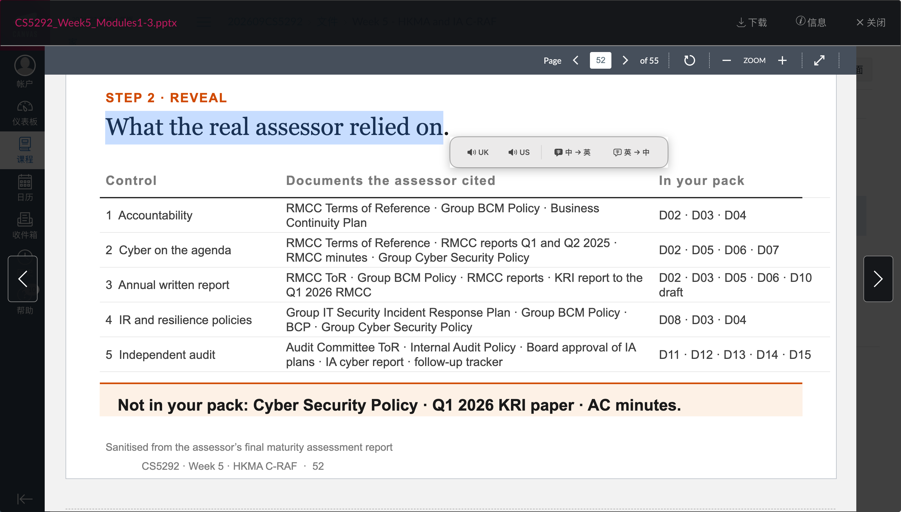

# SelectionPal（划词助手）

一个免费、轻量、原生的 macOS 全局划词工具。选中文字后，可以直接使用英式或美式发音，也可以在中文和英文之间翻译。



## 为什么做这个工具

Easydict 的功能很完整，但对我来说有些过于复杂，其中不少功能在日常复习时并不会用到。PopClip 的交互更简洁、产品也比较成熟，但需要付费使用。

因此，我做了 SelectionPal：一个面向复习场景的小型划词工具，只保留英式发音、美式发音和中英文互译这些常用功能，希望在阅读课件和资料时做到划词即用，尽量减少额外操作和干扰。

目前仅支持 macOS，暂不支持 Windows 和 Linux。

## 功能

- 全局鼠标划词后显示原生悬浮操作条
- 英式英语和美式英语朗读
- 中文翻译为英文、英文翻译为中文
- 支持 Codex 等未完整暴露辅助功能选区的应用
- 兼容取词后完整恢复原剪贴板
- 点击其他位置、滚动、切换窗口或按键时自动关闭
- 自动适配 macOS 浅色和深色外观
- 不需要账号或 API Key

## 系统要求

- macOS 15 或更高版本
- Swift 6.2 / Xcode 26（仅构建时需要）
- 需要授予辅助功能权限

## 构建

```bash
chmod +x build-app.sh
./build-app.sh
open "dist/划词助手.app"
```

构建产物位于 `dist/划词助手.app`。

## 使用

1. 启动“划词助手”。
2. 打开“系统设置 → 隐私与安全性 → 辅助功能”。
3. 允许“划词助手”访问辅助功能。
4. 在任意支持的应用中拖动选择文字，或者双击选择单词。
5. 在悬浮操作条中选择英式发音、美式发音或翻译方向。

翻译首次使用时，macOS 可能提示下载对应语言包。

## 隐私

- 应用仅在用户主动划词后读取当前选区。
- 不记录或保存所选文字。
- 语音使用 macOS 系统语音合成。
- 翻译使用 Apple Translation 框架。
- 兼容模式会临时复制选区，并在读取后恢复原剪贴板内容。

## 已知限制

- 当前仅支持 macOS。
- 部分应用可能阻止辅助功能读取或模拟复制，因此无法获取选区。
- 本地构建采用临时签名；公开分发需要 Apple Developer ID 签名和公证。

## License

[MIT](LICENSE)
